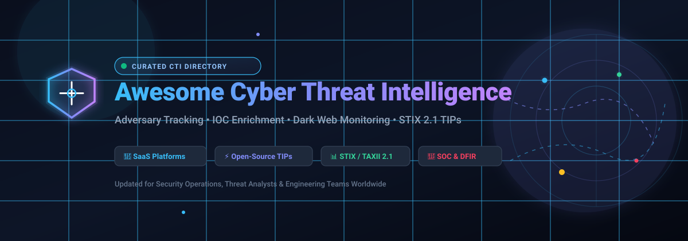
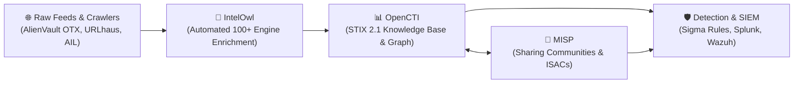

  

# Awesome Cyber Threat Intelligence (CTI) 🛡️

  
  
  
  
  
  
  

A curated collection of top **Cyber Threat Intelligence (CTI)** resources, enterprise **SaaS Threat Intelligence Platforms (TIP)**, and self-hosted **Open-Source CTI Projects**. 🚀

Designed for **SOC Analysts**, **Security Engineers**, **Threat Hunters**, **DFIR Practitioners**, and **Infosec Teams** engaged in:
- 🎯 **Adversary Tracking & Threat Actor Profiling**
- 🔍 **IOC Enrichment, Correlation & Feeds**
- 🌐 **Dark Web & External Attack Surface Monitoring (EASM)**
- 📊 **STIX/TAXII Standards & Threat Knowledge Graphs**
- 🤝 **Information Sharing & ISAC Communities**

---

## 📑 Table of Contents

- [Sector Overview & Market Dynamics](#-sector-overview--market-dynamics)
- [Enterprise SaaS & Commercial Threat Intelligence Platforms](#-enterprise-saas--commercial-threat-intelligence-platforms)
- [Open-Source Threat Intelligence Platforms (TIP) & Tools](#-open-source-threat-intelligence-platforms-tip--tools)
  - [Core Open-Source Projects (Ranked by GitHub_Stars)](#-core-open-source-projects-ranked-by-github-stars)
  - [Dissemination & Frameworks](#-dissemination--frameworks)
- [Recommended Open-Source CTI Architecture Stack](#-recommended-open-source-cti-architecture-stack)
- [How to Choose the Right CTI Tool](#-how-to-choose-the-right-cti-tool)
- [Star History](#-star-history)
- [Support](#-support)
- [How to Contribute](#-how-to-contribute)
- [Disclaimer & Guidelines](#-disclaimer--guidelines)

---

## 📈 Sector Overview & Market Dynamics

The global Cyber Threat Intelligence (CTI) market is estimated at **$9.2B–$11.8B in 2025/2026** and projected to exceed **$20B by 2030–2032**, expanding at a robust compound annual growth rate (CAGR) of **~14% to 18%**. 

The sector is **moderately fragmented** rather than winner-take-all: while mega-cap tech and defense conglomerates (e.g., Microsoft, Alphabet/Google Cloud, Palo Alto Networks, CrowdStrike) command significant baseline cybersecurity spend, no single vendor captures a dominant majority of specialized threat intelligence operations. Instead, pure-play intelligence specialists (Recorded Future, Flashpoint), external risk platforms (ZeroFox), and mature open-source ecosystems (OpenCTI, MISP) maintain critical footholds across public sector agencies, CERTs, and multi-cloud enterprise defense architectures.

---

## 🏢 Enterprise SaaS & Commercial Threat Intelligence Platforms

Sorted by company size (market capitalization / acquisition valuation, descending) 📊:

| Platform | Company Valuation / Revenue Size | Starting Tier Pricing | Free Tier / Trial Plan Limits | Primary Focus & Strength |
| :--- | :--- | :--- | :--- | :--- |
| **[Microsoft Defender Threat Intelligence](https://www.microsoft.com/security/)** | **~$3.1 Trillion** (Parent: Microsoft Corp / $245B+ ARR) | Included with Defender for Endpoint Plan 2 ($5.20/user/mo) or Sentinel ingestion ($2.46/GB) | **No standalone free tier**; 30-day free trial of Microsoft Defender XDR / Sentinel with up to 10 GB/day ingestion free | Native automated integration across Microsoft 365, Azure Sentinel, and Windows telemetry |
| **[Mandiant Threat Intelligence](https://www.mandiant.com/)** | **~$2.1 Trillion** (Parent: Alphabet; acquired for $5.4B) | Starts at **$25,000/year** for Security Operations subscription tier | **Mandiant Advantage Free**: Free forever plan with dynamic actor profiles, MITRE ATT&CK pivot maps, and daily indicator lookups/downloads | Unmatched human incident response breach investigations, reverse engineering, and APT attribution |
| **[Palo Alto Unit 42](https://www.paloaltonetworks.com/)** | **~$105 Billion** (Market Cap / $8.0B+ ARR) | Unit 42 Continuous Frontier AI defense starts at **$45,000/year** baseline subscription | **No free tier**; 14-day guided proof-of-concept (PoC) scoped to customer attack surfaces | Agentic offensive security, automated exposure discovery, and proactive attack simulation |
| **[CrowdStrike Falcon Intelligence](https://www.crowdstrike.com/)** | **~$75 Billion** (Market Cap / $3.9B+ ARR) | **Falcon Pro starts at $14.99/device/month** (Falcon Enterprise: $19.99/device/month) | **Falcon Go Free**: Free forever tier for up to 100 devices with foundational Threat Intelligence & Hunting | Endpoint telemetry correlation, automated file/malware sandboxing, and real-time hunting IOCs |
| **[Recorded Future](https://www.recordedfuture.com/)** | **$2.65 Billion** (Acquired by Mastercard; $300M+ ARR) | Single-module Core package starts at **$40,000/year** (Standard tiers average $75k–$150k/yr) | **No free tier**; 14-day evaluation access upon sales approval and technical scoping | High-scale automated web/dark-web collection, AI-powered Intelligence Graph, and real-time risk scoring |
| **[Rapid7 IntSights](https://www.rapid7.com/)** | **~$2.2 Billion** (Market Cap / $820M+ ARR; IntSights acquired for $335M) | Exposure Command bundle starts at **$10,000/year** based on external assets | **No free tier**; 30-day trial of Rapid7 Insight platform with scoped external threat monitoring demo | Unified exposure management combining dark web scanning with vulnerability remediation workflows |
| **[Flashpoint](https://flashpoint.io/)** | **~$1.0 Billion** (Valuation / ~$120M ARR; backed by Audax) | Flashpoint Ignite single-module starts at **$14,500/year** per module license | **No free tier**; 21-day guided trial available via AWS Marketplace or direct enterprise request | Deep underground cybercrime forums, illicit community monitoring, ATO credential feeds, and non-CVE vuln tracking |
| **[ZeroFox](https://www.zerofox.com/)** | **~$350 Million** (Acquired by Haveli Investments; ~$230M ARR) | Foundation Package starts at **$18,000/year** based on brand asset scope | **No free tier**; 14-day proof-of-concept (PoC) with guided takedown demonstration | Digital Risk Protection (DRP), active anti-phishing takedowns, and brand spoofing disruption |
| **[ThreatConnect](https://threatconnect.com/)** | **~$250 Million** (Valuation; backed by Providence Strategic Growth) | Base TI Ops platform contracts start at **$60,000/year** for standard team tier | **No free tier**; 30-day custom proof-of-concept (PoC) for verified security operations teams | Threat Intelligence Operations (TI Ops), multi-feed scoring, and SOAR orchestration |
| **[Cybersixgill](https://cybersixgill.com/)** | **~$150 Million** (Acquired by Bitsight) | Maltego dark web data integration starts at **$3,000/year**; enterprise platform at **$25,000/year** | **No free tier**; 90-day trial for qualifying organizations through Microsoft Copilot ecosystem integrations | Automated dark web data lake, covert underground forum harvesting, and automated foreign-language translation |

---

## ⚡ Open-Source Threat Intelligence Platforms (TIP) & Tools

### 🌟 Core Open-Source Projects (Ranked by GitHub_Stars)

Sorted strictly by GitHub Stars_Counts (descending) 🌟:

| Open-Source Project | GitHub_Stars_Badge | License & Stack | Description & Core Use Case |
| :--- | :--- | :--- | :--- |
| **[Sigma](https://github.com/SigmaHQ/sigma)** |  | `CC-BY-4.0`   `YAML / Python` | **Generic Signature Format for SIEM Systems**: The industry standard for describing log events and threat-detection signatures in an open, vendor-neutral rule format. |
| **[OpenCTI](https://github.com/OpenCTI-Platform/opencti)** |  | `Apache-2.0`   `Python / GraphQL / Elasticsearch` | **Unified CTI Knowledge Management**: The leading STIX 2.1-native open-source platform for mapping adversary TTPs, campaigns, observables, and threat-actor relationships into intuitive graph structures. |
| **[Maltrail](https://github.com/stamparm/maltrail)** |  | `GPL-2.0`   `Python` | **Malicious Traffic Detection System**: Utilizes publicly available blacklists and threat intelligence feeds to actively identify malicious traffic, DNS requests, and IP connections in real time. |
| **[MISP](https://github.com/MISP/MISP)** |  | `AGPL-3.0`   `PHP / MySQL` | **Malware Information Sharing Platform**: The global standard open-source platform for storing, correlating, and federating IOCs across CERTs, ISACs, and government agencies worldwide. |
| **[YARA-Rules](https://github.com/Yara-Rules/rules)** |  | `GPL-2.0`   `YARA` | **Open-Source Repository of YARA Rules**: Curated community repository containing thousands of detection rules for malware families, vulnerabilities, and exploit kits. |
| **[IntelOwl](https://github.com/intelowlproject/IntelOwl)** |  | `AGPL-3.0`   `Python / Django / Celery` | **Automated Observable & Threat Enrichment**: Orchestrates lookups across 100+ threat intelligence APIs (VirusTotal, AbuseIPDB, GreyNoise, Shodan) via a single REST call or UI. |
| **[TheHive (v3/v4)](https://github.com/TheHive-Project/TheHive)** |  | `AGPL-3.0`   `Scala / Elasticsearch` | **Security Incident Response Platform**: Collaborative open-source SOAR and DFIR ticketing tool closely integrated with MISP for alert-to-investigation workflows (*Note: v5+ is commercial*). |
| **[MITRE CTI](https://github.com/mitre/cti)** |  | `Apache-2.0`   `STIX 2.0 / 2.1 JSON` | **Official MITRE ATT&CK & CAPEC STIX Data**: Machine-readable repositories of ATT&CK matrices (Enterprise, Mobile, ICS) expressed in STIX 2.0/2.1 format for automated TIP ingestion. |
| **[Yeti](https://github.com/yeti-platform/yeti)** |  | `Apache-2.0`   `Python / FastAPI / MongoDB` | **Observable & Indicator Organizer**: Lightweight platform geared towards DFIR specialists for tracking IOCs, mapping indicators to investigations, and exposing clean REST endpoints. |
| **[AIL Framework](https://github.com/ail-project/ail-framework)** |  | `GPL-3.0`   `Python` | **Analysis Information Leak Framework**: Robust open-source framework developed by CIRCL to collect, crawl, and analyze unformatted text, pastes, and dark web leaks for credential dumps. |
| **[Threat Bus](https://github.com/tenzir/threatbus)** |  | `BSD-3-Clause`   `Python` | **Threat Dissemination Layer**: Lightweight publish-subscribe message broker that interconnects CTI tools (OpenCTI, MISP) with detection engines (Zeek, Suricata). |

---

### 🛠️ Dissemination & Frameworks

- **[Threat Bus](https://github.com/tenzir/threatbus)**: Dissemination layer connecting telemetry tools to threat sharing backends.
- **[AIL Framework](https://github.com/ail-project/ail-framework)**: Dark web crawling and credential breach leak detection engine.
- **[CybOX Project](https://github.com/CybOXProject/schemas)**: Cyber Observable Expression schemas foundational to STIX standardization.

---

## 🏗️ Recommended Open-Source CTI Architecture Stack

For security teams building a complete, license-free, end-to-end self-hosted Threat Intelligence pipeline:

1. 📥 **Collection & Leaks**: **[AIL Framework](https://github.com/ail-project/ail-framework)** collects text and dark-web pastes; raw feeds ingest external IOCs.
2. 🔍 **Automated Enrichment**: **[IntelOwl](https://github.com/intelowlproject/IntelOwl)** queries over 100 OSINT scanners and APIs concurrently.
3. 🧠 **Knowledge Modeling**: **[OpenCTI](https://github.com/OpenCTI-Platform/opencti)** synthesizes enriched data into STIX 2.1 adversary graphs and ATT&CK maps.
4. 🤝 **Community Sharing**: **[MISP](https://github.com/MISP/MISP)** synchronizes vetted indicators with external trust circles, ISACs, and national CERTs.
5. 🛡️ **Detection Rules**: **[Sigma](https://github.com/SigmaHQ/sigma)** converts CTI patterns into vendor-agnostic detection signatures for SIEM/EDR.

---

## 🎯 How to Choose the Right CTI Tool

| Use Case | Recommended Solution | Primary Selection Rationale |
| :--- | :--- | :--- |
| **ISAC & Community Sharing** | **[MISP](https://github.com/MISP/MISP)** | Proven global protocol for secure, authenticated multi-organization IOC exchange. |
| **Adversary Graph & STIX Modeling** | **[OpenCTI](https://github.com/OpenCTI-Platform/opencti)** | Best-in-class UI for entity relationships, threat campaigns, and ATT&CK alignment. |
| **High-Throughput IOC Triage** | **[IntelOwl](https://github.com/intelowlproject/IntelOwl)** | Single-call multi-engine API enrichment eliminating manual analyst lookups. |
| **Detection Engineering & Rules** | **[Sigma](https://github.com/SigmaHQ/sigma)** | Convert adversary behaviors into universal detection signatures across SIEM platforms. |
| **Breach Response & APT Intel** | **[Mandiant](https://www.mandiant.com/)** | Elite frontline forensic telemetry directly from top-tier incident responders. |
| **Web-Scale All-Source Graph** | **[Recorded Future](https://www.recordedfuture.com/)** | Predictive intelligence graph covering open, deep, and dark web sources at scale. |
| **Dark Web & Illicit Markets** | **[Flashpoint](https://flashpoint.io/)** | Comprehensive coverage of closed underground forums, ransomware blogs, and credential leaks. |
| **External Brand & Takedowns** | **[ZeroFox](https://www.zerofox.com/)** | Dedicated disruption workflows for phishing sites, rogue domains, and impersonation. |

---

## 📊 Star History

---

## ☕ Support

If you find this curated CTI directory helpful:
- ⭐ **Star this repository** to help other cybersecurity practitioners discover it!
- 🍴 **Fork it** to contribute new open-source projects or updated pricing data.
- 📢 **Share it** on LinkedIn, X/Twitter, or security community Discords.
- ☕ **Buy me a coffee**: Support ongoing curation and maintenance via the [GitHub Sponsors Dashboard](https://github.com/sponsors/ishandutta2007).

---

## 🤝 How to Contribute

Contributions are welcome! Help keep this cyber threat intelligence directory accurate and up to date:

1. Fork this repository.
2. Create a new branch: `git checkout -b add-threat-tool`.
3. Add your entry following the established schema (include tool name, website/repo link, verified pricing/license, and objective summary).
4. Commit your changes and submit a Pull Request.

---

## ⚠️ Disclaimer & Guidelines

- **Community-Curated**: This list is for educational, defensive, and research purposes. Inclusion does not imply official endorsement.
- **Regulatory Compliance**: Threat intelligence systems ingesting dark web or leaked database data must adhere to relevant compliance and privacy laws (e.g., GDPR, CCPA).
- **Infrastructure Requirements**: Self-hosting modern platforms (OpenCTI, MISP) requires proper operational security, regular backups, and dedicated infrastructure (Elasticsearch, Redis, Relational DBs).

---

  <i>Curated with ❤️ for the global cybersecurity and threat intelligence defense community.</i>

