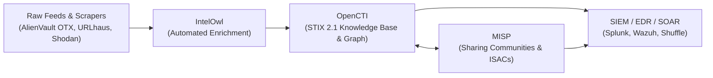

# Awesome Cyber Threat Intelligence (CTI) 🛡️

A curated collection of top **Cyber Threat Intelligence (CTI)** resources, enterprise **SaaS Threat Intelligence Platforms (TIP)**, and self-hosted **Open-Source CTI Projects**. 

Designed for **SOC Analysts**, **Security Engineers**, **Threat Hunters**, **DFIR Practitioners**, and **Infosec Teams** engaged in:
- 🎯 **Adversary Tracking & Threat Actor Profiling**
- 🔍 **IOC Enrichment, Correlation & Feeds**
- 🌐 **Dark Web & External Attack Surface Monitoring (EASM)**
- 📊 **STIX/TAXII Standards & Threat Knowledge Graphs**
- 🤝 **Information Sharing & ISAC Communities**

---

## Table of Contents

- [Quick Comparison & Overview](#quick-comparison--overview)
- [Enterprise SaaS & Commercial Threat Intelligence Platforms](#enterprise-saas--commercial-threat-intelligence-platforms)
- [Open-Source Threat Intelligence Platforms (TIP) & Tools](#open-source-threat-intelligence-platforms-tip--tools)
  - [Core Open-Source Platforms](#core-open-source-platforms)
  - [Dissemination & Investigation Frameworks](#dissemination--investigation-frameworks)
- [Recommended Open-Source CTI Architecture Stack](#recommended-open-source-cti-architecture-stack)
- [How to Choose the Right CTI Tool](#how-to-choose-the-right-cti-tool)
- [How to Contribute](#how-to-contribute)
- [Disclaimer & Guidelines](#disclaimer--guidelines)

---

## Quick Comparison & Overview

### SaaS & Enterprise CTI Platforms Pricing & Capabilities

| Platform | Category / Focus | Free Tier & Limits | Pricing Model | Key Strength |
| :--- | :--- | :--- | :--- | :--- |
| **[CrowdStrike Falcon Intelligence](https://www.crowdstrike.com/)** | Endpoint Telemetry & Threat Hunting | **Yes**: Falcon Go Free (up to 100 devices; includes basic intel & hunting) | Paid plans start at $14.99/device/month (Falcon Pro); Falcon Enterprise $19.99/mo; Complete $59.99–$184.99/yr; expansion packs separate | Tight integration with endpoint telemetry, automated sandbox analysis |
| **[Recorded Future](https://www.recordedfuture.com/)** | Intelligence Graph & All-Source CTI | **No** (Quote / POC only) | Custom Quote (Core, Professional, Elite tiers) | Massive automated web/dark-web collection, AI-driven Intelligence Graph |
| **[Mandiant Threat Intelligence](https://www.mandiant.com/)** | Frontline IR Telemetry & Actor Tracking | **Yes**: Mandiant Advantage Free (dynamic actor pivot, MITRE ATT&CK maps, indicator lookups/downloads, API access) | Custom Quote (Security Operations & Fusion tiers) | Elite frontline breach response insights and actor attribution |
| **[Flashpoint](https://flashpoint.io/)** | Illicit Communities & Fraud Intelligence | **No** | Custom Quote | Unrivaled illicit community and underground forum access |
| **[Palo Alto Unit 42](https://www.paloaltonetworks.com/)** | Offensive AI Defense & Exposure Assessment | **No** | Annual subscription; Quote-only | Agentic offensive AI discovery and frontline incident triage |
| **[Microsoft Defender Threat Intelligence](https://www.microsoft.com/security/)** | XDR & SIEM Embedded Intel | **No standalone free tier** (Embedded with Defender XDR / Sentinel licenses) | Included with eligible Microsoft Defender / Sentinel licensing | Native ingestion into Sentinel and Microsoft 365 Defender workflows |
| **[IntSights (Rapid7)](https://www.rapid7.com/)** | External Threat Protection & Dark Web | **No** | Custom Quote | Rapid external exposure alerts directly connected into Rapid7 ecosystem |
| **[ZeroFox](https://www.zerofox.com/)** | Digital Risk Protection & Takedowns | **No** | Outcome-based custom pricing | Automated global takedowns and brand abuse disruption |
| **[Cybersixgill](https://cybersixgill.com/)** | Dark Web & Underground Cybercrime Data | **No** (Trial upon request) | Subscription-based; Custom Quote | Comprehensive automated dark web data lake with real-time scraping |
| **[ThreatConnect](https://threatconnect.com/)** | Threat Intelligence Operations (TI Ops) | **No** (Enterprise demo/trial available) | Custom Quote | Multi-source ingestion, playbook automation, and MITRE ATT&CK mapping |

---

## Enterprise SaaS & Commercial Threat Intelligence Platforms

### [CrowdStrike Falcon Intelligence](https://www.crowdstrike.com/)
- **Overview**: Leader in the Gartner Magic Quadrant for Cyberthreat Intelligence Technologies. Integrates actionable intelligence natively with endpoint telemetry.
- **Key Capabilities**: Automated malware detonation, IOC enrichment, sandbox integration, adversary profiles, and threat hunting correlation.
- **Free Tier**: **Falcon Go** provides free tier coverage for up to 100 devices including Threat Intelligence & Hunting.
- **Pricing**: Commercial tiers start at $14.99/device/month (Falcon Pro), $19.99 (Falcon Enterprise), and $59.99–$184.99/device annually (Falcon Complete). Falcon Intelligence Expansion Pack available as add-on.
- **Best For**: Organizations prioritizing intelligence coupled directly with endpoint detection and response (EDR/XDR).

### [Recorded Future](https://www.recordedfuture.com/)
- **Overview**: Enterprise-grade all-source intelligence platform powered by an AI-driven real-time Intelligence Graph.
- **Key Capabilities**: External threat hunting, digital risk protection (DRP), third-party risk analysis, and automated brand tracking across surface, deep, and dark web.
- **Pricing**: Quote-only based on three modular tiers: *Core*, *Professional*, and *Elite*.
- **Best For**: Large security operations centers (SOCs) wanting broad predictive intelligence and comprehensive risk visibility.

### [Mandiant Threat Intelligence](https://www.mandiant.com/)
- **Overview**: Premier cyber threat intelligence grounded in real-world breach response, reverse engineering, and frontline telemetry.
- **Key Capabilities**: In-depth threat actor dossiers, dynamic adversary tracking mapped to MITRE ATT&CK, vulnerability prioritization, and IOC scoring.
- **Free Tier**: **Mandiant Advantage Free** provides indicator lookups, MITRE ATT&CK matrix views, threat actor summaries, and API access.
- **Pricing**: Quote-based subscriptions (*Security Operations* and *Fusion*).
- **Best For**: Cyber defense teams needing deep forensic insights and adversary attribution based on actual incident response casework.

### [Flashpoint](https://flashpoint.io/)
- **Overview**: Specialized threat intelligence platform focused on illicit communities, dark web marketplaces, and vulnerability intelligence.
- **Key Capabilities**: Account takeover (ATO) credential monitoring, non-CVE vulnerability database (415k+ entries), fraud intelligence, and physical security tracking (Echosec).
- **Pricing**: Quote-only enterprise licenses.
- **Best For**: Fraud units, threat intelligence teams, and brand protection specialists monitoring underground threat actor operations.

### [Palo Alto Unit 42](https://www.paloaltonetworks.com/)
- **Overview**: Elite threat intelligence, offensive security research, and continuous AI-driven exposure assessment.
- **Key Capabilities**: Continuous Frontier AI Defense, autonomous attack surface testing, proactive hunting, and real-time incident response telemetry.
- **Pricing**: Custom enterprise quote.
- **Best For**: Organizations looking for proactive AI exposure validation alongside elite threat intelligence services.

### [Microsoft Defender Threat Intelligence (MDTI)](https://www.microsoft.com/security/)
- **Overview**: Threat intelligence natively integrated into Microsoft Defender XDR and Microsoft Sentinel SIEM.
- **Key Capabilities**: Intelligence Explorer, raw and finished threat profiles, automated infrastructure tracking, and free Sentinel data connectors.
- **Pricing**: Included with qualifying Defender XDR and Microsoft Sentinel enterprise plans (standalone portal retired).
- **Best For**: Enterprises invested in the Microsoft 365 and Azure security ecosystem.

### [IntSights (Rapid7)](https://www.rapid7.com/)
- **Overview**: External threat protection and digital risk management within Rapid7's Insight platform.
- **Key Capabilities**: Surface, deep, and dark web scraping, credential exposure detection, and perimeter exposure identification.
- **Pricing**: Custom enterprise quote.
- **Best For**: Existing Rapid7 customers seeking automated external threat feeds.

### [ZeroFox](https://www.zerofox.com/)
- **Overview**: External attack surface management and digital risk protection (DRP) featuring an active takedown network.
- **Key Capabilities**: Phishing domain teardowns, social media spoof protection, executive digital protection, and automated threat disruption.
- **Pricing**: Outcome-based custom pricing model.
- **Best For**: Brand security, executive protection, and automated takedowns of impersonating infrastructure.

### [Cybersixgill](https://cybersixgill.com/)
- **Overview**: Real-time automated dark web threat intelligence platform with expansive historical archives.
- **Key Capabilities**: Covert forum collection, automated translation, threat actor chatter tracking, and API feeds into SIEM/SOAR.
- **Pricing**: Custom annual subscription.
- **Best For**: Analysts who need early warning intelligence from deep and dark web threat forums.

### [ThreatConnect](https://threatconnect.com/)
- **Overview**: Threat Intelligence Operations (TI Ops) platform unifying intelligence ingestion, scoring, and orchestration.
- **Key Capabilities**: Aggregation across dozens of threat feeds, automated IOC enrichment, MITRE ATT&CK alignment, and SOC playbook integration.
- **Pricing**: Quote-only enterprise licensing.
- **Best For**: Mature SOC/CTI teams orchestrating multi-source threat data into actionable defense mechanisms.

---

## Open-Source Threat Intelligence Platforms (TIP) & Tools

### Core Open-Source Platforms

#### [MISP - Malware Information Sharing Platform](https://github.com/MISP/MISP)
- **License**: AGPL-3.0 | **Stack**: PHP, MySQL
- **Description**: The gold-standard open-source platform for sharing, correlating, and storing IOCs across organizations, CERTs, and ISACs worldwide.
- **Key Features**: Granular cryptographic distribution controls, MISP taxonomies/galaxies, native STIX/TAXII support, automated feed syncing, and an extensive module ecosystem.
- **Best For**: Organizations participating in community intelligence-sharing rings or building private sharing networks.

#### [OpenCTI](https://github.com/OpenCTI-Platform/opencti)
- **License**: Apache-2.0 | **Stack**: Python, Node.js, GraphQL, Elasticsearch, Redis, RabbitMQ
- **Description**: The industry-leading open-source cyber threat intelligence knowledge management platform, designed entirely on the **STIX 2.1** object model.
- **Key Features**: Visual relationship graphs, attack campaigns/actor tracking, timeline analysis, connector ecosystem (MISP, VirusTotal, AlienVault, MITRE), and robust RBAC.
- **Best For**: Teams building an intelligence-led security program requiring knowledge graphs, complex entity modeling, and STIX 2.1 compliance.

#### [IntelOwl](https://github.com/intelowlproject/IntelOwl)
- **License**: AGPL-3.0 | **Stack**: Python, Django, Celery, RabbitMQ, PostgreSQL
- **Description**: High-throughput automated observable enrichment and OSINT analysis engine.
- **Key Features**: Query 100+ analyzers (VirusTotal, AbuseIPDB, GreyNoise, Shodan, URLScan) with a single API call, file sandbox analysis, and direct OpenCTI/MISP integration.
- **Best For**: Security operations teams needing rapid, multi-engine observable triage and automated enrichment pipelines.

#### [Yeti](https://github.com/yeti-platform/yeti)
- **License**: Apache-2.0 | **Stack**: Python, FastAPI, MongoDB, Redis
- **Description**: Lightweight observable organization platform optimized for the intersection of Digital Forensics and Incident Response (DFIR) and CTI.
- **Key Features**: Fast indicator organization, investigation graphing, automated data feeds, and simple REST API endpoints.
- **Best For**: DFIR analysts and threat hunters tracking custom IOCs across active investigations without heavyweight TIP complexity.

---

### Dissemination & Investigation Frameworks

- **[Threat Bus](https://github.com/tenzir/threatbus)** (BSD-3-Clause): Dissemination bus that routes intelligence between security tools, connecting platforms like OpenCTI and MISP with endpoint sensors and SIEMs.
- **TheHive** (Historical Note): Popular open-source incident response tool (v3/v4 were AGPL-3.0); note that TheHive v5+ has moved to commercial distribution models.

---

## Recommended Open-Source CTI Architecture Stack

For organizations building an end-to-end self-hosted Threat Intelligence pipeline without commercial licensing costs, the battle-tested modern open-source stack is:

1. **Ingestion & Enrichment**: **[IntelOwl](https://github.com/intelowlproject/IntelOwl)** collects observables and queries 100+ threat intelligence APIs.
2. **Knowledge Modeling & Analysis**: **[OpenCTI](https://github.com/OpenCTI-Platform/opencti)** models threat actors, malware families, and TTPs in STIX 2.1.
3. **Information Sharing**: **[MISP](https://github.com/MISP/MISP)** synchronizes and shares high-fidelity IOCs with external CERTs, sector ISACs, and partners.
4. **Actionable Enforcement**: Filtered indicators flow directly into SIEM/EDR detection rules.

---

## How to Choose the Right CTI Tool

| Use Case | Recommended Solution | Rationale |
| :--- | :--- | :--- |
| **Community Sharing & ISAC Sync** | **[MISP](https://github.com/MISP/MISP)** | Established global standard for trusted threat intelligence sharing. |
| **Adversary & TTP Knowledge Modeling** | **[OpenCTI](https://github.com/OpenCTI-Platform/opencti)** | Best-in-class STIX 2.1 graphing and MITRE ATT&CK integration. |
| **Fast IOC Enrichment & Triage** | **[IntelOwl](https://github.com/intelowlproject/IntelOwl)** | Orchestrates dozens of OSINT and API analyzers simultaneously. |
| **Incident Response Telemetry & APT Analysis** | **[Mandiant](https://www.mandiant.com/)** | Unsurpassed human adversary research from real incident response. |
| **All-Source Enterprise Intelligence Graph** | **[Recorded Future](https://www.recordedfuture.com/)** | Automated web-scale collection and predictive risk scoring. |
| **Takedowns & External Brand Protection** | **[ZeroFox](https://www.zerofox.com/)** | Rapid automated disruption of phishing and domain squatting. |

---

## How to Contribute

Contributions are welcome! Help keep this cyber threat intelligence directory accurate and up to date:

1. Fork this repository.
2. Create a new branch: `git checkout -b add-threat-tool`.
3. Add your entry following the established markdown schema (include tool name, website/repo link, license/pricing, and 1–2 sentence objective summary).
4. Commit your changes and submit a Pull Request.

---

## Disclaimer & Guidelines

- **Community-Curated**: This list is for educational, defensive, and research purposes. Inclusion does not imply official endorsement.
- **Regulatory Compliance**: Threat intelligence systems ingesting dark web or leaked database data must adhere to relevant compliance and privacy laws (e.g., GDPR, CCPA).
- **Infrastructure Requirements**: Self-hosting modern platforms (OpenCTI, MISP) requires proper operational security, regular backups, and dedicated infrastructure (Elasticsearch, Redis, Relational DBs).

---

*Curated with ❤️ for the global cybersecurity and threat intelligence defense community.*
